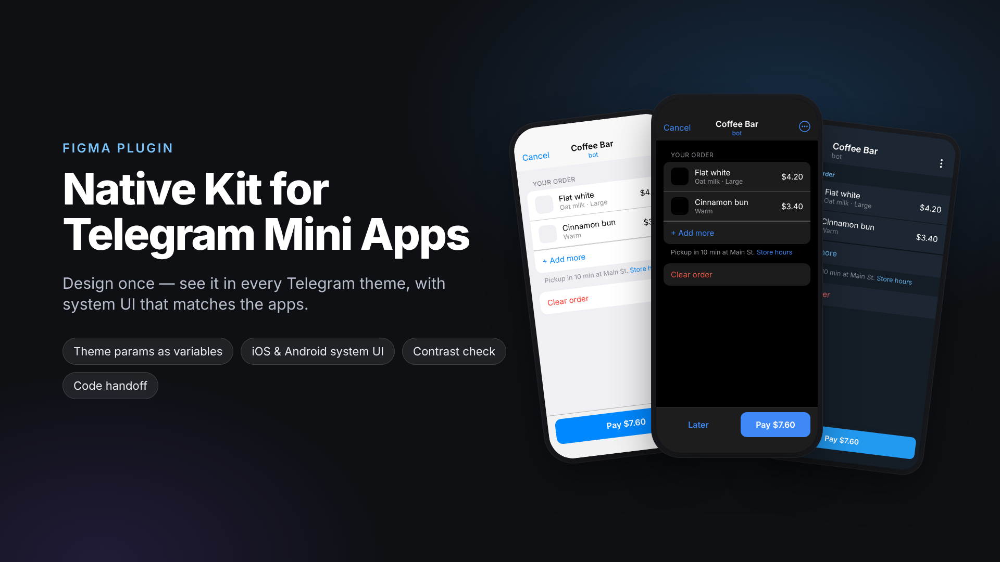
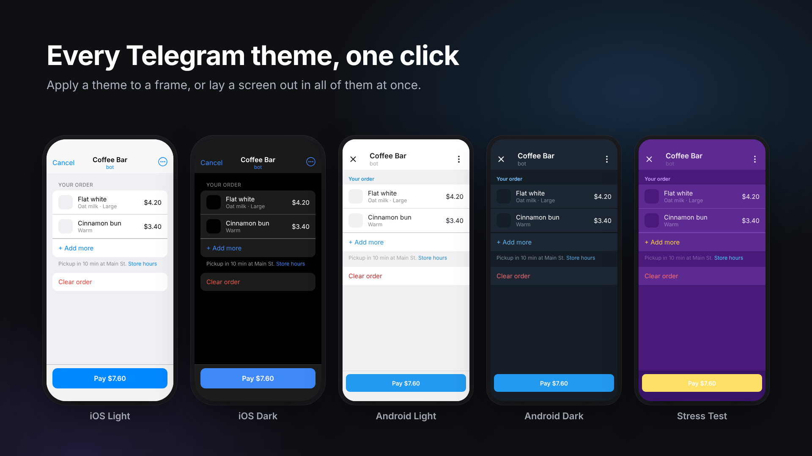
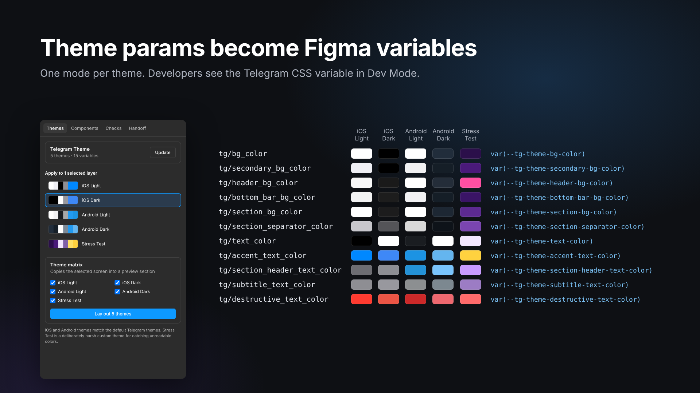
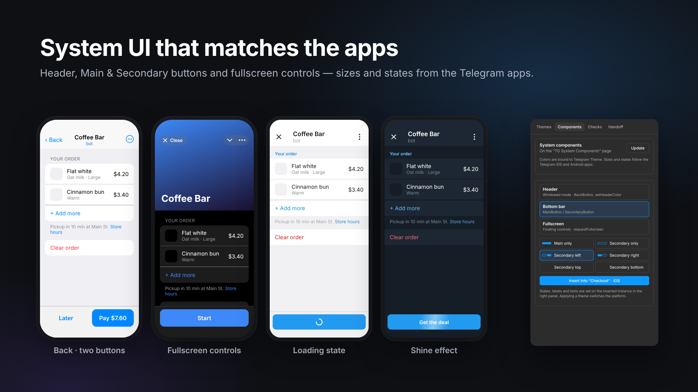
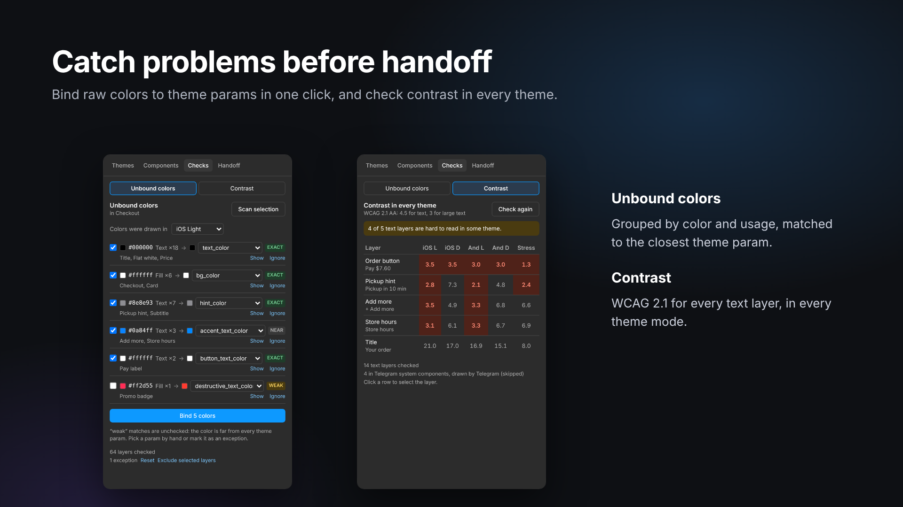
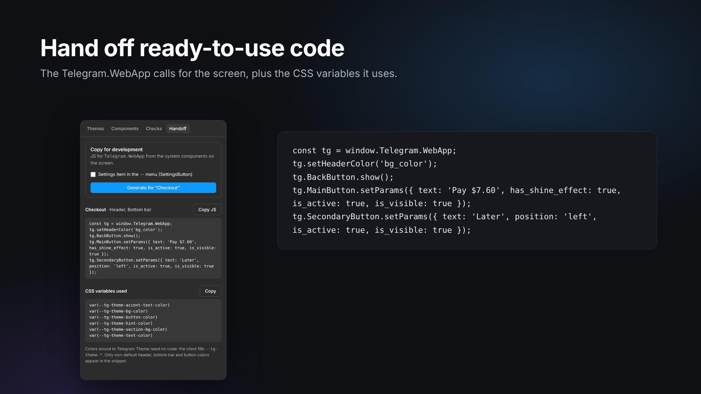

# Native Kit for Telegram Mini Apps

A Figma plugin for designing **native** Telegram Mini Apps — apps that don't have their own palette but take their colors from the theme each user picked in Telegram.

With a native Mini App you never know the exact colors: one person uses iOS in light mode, another Android in dark mode, a third a custom purple theme. Native Kit lets you design with Telegram's theme colors instead of fixed hex values, see every screen in every theme in a click, use system UI that looks like the real Telegram apps, and catch unreadable colors before handoff.

## What it does

- **Telegram theme as Figma variables.** All Telegram theme colors (background, text, hint, link, button…) become variables with a mode for each theme: iOS Light, iOS Dark, Android Light, Android Dark and a harsh Stress Test theme. Developers see the matching Telegram CSS variable in Dev Mode.
- **Every theme in one click.** Switch a screen to any theme, or lay it out in all themes side by side.
- **System components.** Telegram's own header, Main and Secondary buttons with every layout and state, and fullscreen controls — matching the Telegram iOS and Android apps and recoloring with the theme.
- **Checks.** Find colors that aren't tied to the theme and fix them in one click; check text contrast in every theme.
- **Handoff.** Get the code that sets up the screen's buttons and header in Telegram, plus the list of theme variables it uses.

## How to use

### 1. Connect the Telegram theme

Open the plugin, go to **Themes** and click **Connect**. A **Telegram Theme** variable collection appears in your file. Click **Update** later to refresh it — nothing gets duplicated.

### 2. Draw with theme colors

When you pick a fill or text color, choose a variable from **Telegram Theme** (`tg/bg_color`, `tg/text_color`, `tg/button_color`…) instead of a hex value. Only colors tied to these variables change with the theme.

Already have a screen with plain colors? See step 5 — the plugin binds them for you.

### 3. Switch themes

Select a screen and click a theme in the **Themes** tab. The screen recolors instantly, and system components switch to the right platform (iOS or Android). The screen's own background is tied to the theme automatically.

To compare themes, use **Theme matrix**: select a screen, tick the themes and click **Lay out themes**. Copies of the screen in every theme appear next to it. Run it again after editing the screen to refresh the copies; the original screen is never changed.

### 4. Add Telegram's system UI

Go to **Components** and click **Create** once — the components appear on a **TG System Components** page. Then select a screen, choose what to add and click **Insert**:

- **Header** — the top bar of a Mini App: Close or Back on the left, title, ⋯ menu. The *Color* option matches what the app sets with `setHeaderColor`.
- **Bottom bar** — the Main and Secondary buttons in any layout. On the inserted instance, change each button's text and state (Pressed, Inactive, Loading, Shine) in the right panel.
- **Fullscreen** — the floating Close and ⋯ controls of fullscreen mode. Turn on **Safe area guide** on the instance to see where content is safe from the notch and the controls.

### 5. Check the screen

Go to **Checks**:

- **Unbound colors** — select a screen and click **Scan selection**. The plugin lists colors that aren't tied to the theme, grouped by color, and suggests the right theme color for each (white text → button text, white fill → background…). Click **Bind** to fix them all. Mark illustrations, photos and logos with **Exclude selected layers** so they're left alone.
- **Contrast** — click **Check selection** to see how readable every text is in every theme. Red cells are below the WCAG accessibility minimum.

### 6. Hand off to developers

Go to **Handoff**, select a screen and click **Generate**. The plugin reads the header, buttons and fullscreen controls on the screen and writes the code that sets them up in Telegram. Copy it, together with the list of theme variables, and send it to your developer.

## FAQ

**Why doesn't a layer change color when I switch themes?**
Its color isn't tied to a Telegram Theme variable. Run **Checks → Unbound colors** to find and bind it.

**What is the Stress Test theme?**
A deliberately unusual custom theme (purple background, light button with light text). Users can set any colors in Telegram, so if your screen survives this theme, it will survive theirs.

**Which Figma plan do I need?**
Any plan with at least 5 variable modes per collection (Professional, Education and above). On a plan with fewer modes the plugin tells you which themes didn't fit.

**Is Telegram Desktop supported?**
Not yet — iOS and Android are. Desktop is coming once it's verified against the Telegram Desktop app.

**Does the plugin send my designs anywhere?**
No. It has no network access and only works inside the current file.

## Feedback

Found a bug or missing something? [Open an issue](https://github.com/cybertatar/tgminiappfigmaplugin/issues).

Not affiliated with or endorsed by Telegram.

---

Building the plugin yourself: [docs/DEVELOPMENT.md](docs/DEVELOPMENT.md).
